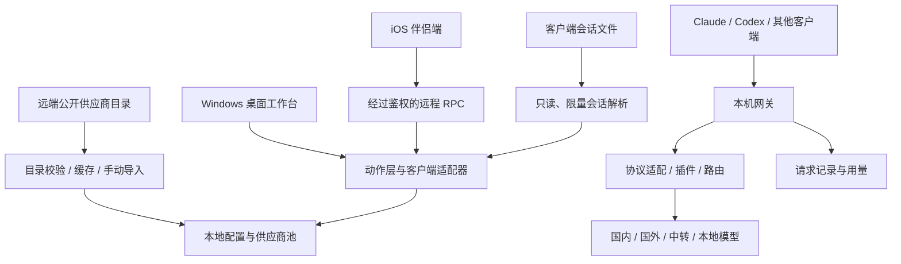

# 云汇 AI · yunhui.me · 产品与实现设计

设计日期：2026-11-15。本文描述产品设计和验收边界，不把设计项自动当作已交付功能。

## 1. 产品定位

一个以客户端为入口的 AI 工作台。用户先选择「我正在使用什么客户端」，再为这个客户端选择供应商、模型和接入方式。高级用户可以继续管理共用的供应商池、路由、插件、会话及请求日志。

核心路径：

**选择客户端 → 选择或新增供应商 → 选择模型 → 查看配置预览 → 应用并验证。**

首次使用不要把用户丢进供应商数据库，也不要先要求用户理解 Anthropic / Responses / Chat 的区别。协议根据客户端和供应商预设解释，详细字段放入高级设置。

## 2. 关键概念

| 概念 | 含义 | 示例 |
| --- | --- | --- |
| 客户端 | 用户运行的应用；有独立版本、平台、配置格式及功能边界 | Claude Code、Claude Desktop、Codex CLI、Codex Desktop、ChatGPT Desktop、WorkBuddy |
| 厂商 | 模型的研发方，供浏览和筛选 | OpenAI、Anthropic、DeepSeek、阿里、智谱 |
| 供应商 | 提供 API 的连接实例；同一厂商可有多个供应商 | DeepSeek 官方、某中转站、公司网关、本机 Ollama |
| 模型 | 一个供应商实际可请求的模型及能力 | 模型 ID、显示名、上下文、工具/视觉能力、价格 |
| 客户端绑定 | 某客户端使用哪个供应商/模型及接入方式 | Codex CLI → 公司网关 → 指定模型 |
| 路由组 | 多个供应商/模型候选，作为一个逻辑模型使用 | 日常编程、低成本、优先稳定 |
| 插件 | 云汇 AI 本身的扩展，不自动等于客户端 MCP 或 Skill | 模型别名、请求参数、系统提示 |

用户在供应商池编辑连接信息，客户端绑定只引用它；不能为每个客户端复制一份 Key 后失去同步。模型目录保留远端提供的原始 ID，不把展示名称直接当成 API 参数。

## 3. 界面与信息架构

采用中文优先、明亮中性色、低饱和青绿/蓝色强调、清晰卡片层次。深色主题作为同等支持的选择。状态使用文字和图形共同表达，不能只靠颜色。表单字号、间距和按钮位置保持一致；搜索、错误、空状态、加载状态都必须完整。

| 页面 | 用户要完成的事 |
| --- | --- |
| 工作台 / 客户端 | 选客户端、看接入状态、选择或新增供应商、切模型、配置预览、备份与恢复 |
| 供应商 | 搜索、按地区/类型筛选、云端导入、API Key、协议/地址、连通性、模型同步 |
| 模型 | 按厂商与供应商浏览、能力筛选、上下文与价格、精确模型 ID、绑定入口 |
| 路由 | 组成员、优先级、重试与冷却、禁用成员、解释实际选择结果 |
| 插件与扩展 | 内置插件、已安装插件、启停与设置；明确 MCP / Skills / 提示词的独立含义 |
| 历史会话 | 按客户端/项目搜索，阅读、导出、复制恢复命令；说明解析范围 |
| 用量与日志 | 请求成功率、Token、估算费用、缓存、首字耗时、失败原因 |
| 系统设置 | 外观、启动托盘、网关、访问令牌、代理、远端目录、更新、数据目录 |

客户端详情中的「新增供应商」应在当前流程完成，并自动选中新建结果。保存后回到当前客户端，不能让用户重新寻找入口。配置预览隐藏密钥，但清楚显示目标路径、改动字段和生效条件。

## 4. 客户端能力分级

不能把「生成一份环境变量文本」描述成「已接入桌面应用」。每个适配器声明接入能力、适用平台、文档链接和生效方式。

1. **可自动配置**：有已核实的配置文件或官方 Gateway 接口。写入前备份，应用后校验，并提供恢复。
2. **需手动设置**：该客户端允许自定义服务，但缺少稳定自动配置入口。提供可复制的 URL、模型与步骤，完成前显示「待手动配置」。
3. **仅官方服务 / 尚未验证**：保持可见，解释现有边界，给出官方入口或可替代的 API 客户端。不能写入猜测的配置文件后宣称成功。

Claude Desktop 必须以当前版本官方 Gateway/企业配置文档为准，与 Claude Code 的配置方式分别处理。0.6 将 ChatGPT、Beta 与原 Codex 桌面应用归入统一入口，仍按实际安装资源和原生接口判断能力；旧聊天版不会因名称相近被判为可接入。DeepSeek 官网客户端不等于支持 OpenAI API 的第三方聊天工具。WorkBuddy 与 CodeBuddy 的协议和配置路径应分别验证。

接入动作要求：合法 URL/协议/模型检查 → 读取原配置 → 生成预览 → 检查文件是否变化 → 备份 → 原子写入 → 重新解析 → 保存绑定。无法解析的原配置拒绝覆盖。恢复时处理用户在接入后新增的字段，不能默认拿旧整文件覆盖新内容。

## 5. 技术分层

继续使用已有 Electron + React + TypeScript，避免把已经具备的协议和网关能力全部重写。主进程负责文件、网络和桌面集成；渲染进程只使用受控 IPC。移动端采用 Capacitor，调用共享动作层，但远程动作使用明确白名单，不能开放任意本机执行或插件脚本写入。

JSON 存储适合现阶段配置；高频请求日志分片追加。会话读取必须有大小/数量限制并明确截断，不对完整历史做无界限反复扫描。后续若检索规模扩大，再迁移索引层至 SQLite，不把存储选型等同于功能质量。

## 6. 网关与兼容性

已有四种协议适配可继续使用，但「存在转换器」不等于「任意模型完全兼容」。验收使用明确的客户端 → 协议 → 上游组合。

- 同协议优先保留原语义；跨协议测试消息、工具调用/结果、流式终止、错误、推理字段。
- 不能伪造官方签名或把加密压缩摘要当普通文本交给别的账号；不兼容时解释原因。
- 一次会话换供应商之前说明：历史可见性和上下文可续接是两件事。读取聚合历史不会自动解决加密上下文迁移。
- 只有尚未向客户端交付输出时才能透明重试；输出一半后不得重放而导致工具重复执行。
- 401、429、超时、上游错误分别记录，展示候选选择原因；费用来自明确价格与用量，没有价格时应标为未知或估算。
- 上下文上限取配置/模型能力，有上游验证依据才宣称生效；不得硬编码一个值覆盖所有模型。

## 7. 远端目录

默认读取 `https://yunhui.me/pub.php?action=catalog`。这个接口只发布供应商预设、模型元数据、文档链接、目录版本和更新时间，不发布用户密钥。

客户端保存最近一次通过结构校验的目录；网络失败仍能使用已配置供应商。云端更新先更新目录，不静默覆盖本机自定义 URL、Key、模型或启用状态。导入显示来源和差异。后台凭据只用于部署，不能编入安装包、JS、日志或目录 JSON。

升级信息与供应商目录分开解析。下载链接、版本和摘要应可核对，不把远端目录当作可以任意执行的代码。

## 8. iOS 的产品边界和交付

iOS 设计为独立伴侣应用：内置连接与管理界面，输入电脑/服务器地址和访问令牌，查看状态、供应商、模型、请求与会话，并在支持的客户端上切换已有绑定。当前未提供已签名 IPA，未签名设备产物不能直接安装到 iPhone。网关与 API Key 留在电脑/服务器，手机不伪装成后台常驻 AI 代理。

移动界面使用底部导航，内容兼容安全区域与系统大字号。地址可以保存；令牌默认只存当前应用会话，断开即清除。连接失败有明确提示，不能只显示一个永远加载的远端网页。

Windows 可以构建 Electron 安装包。iOS 原生编译必须由 macOS + Xcode 完成：CI 分别构建模拟器 `.app` 和未签名 iPhoneOS `.app`；可安装到真机的 `.ipa` 还需要有效 Team、签名证书与描述文件。生成工程、模拟器构建、设备编译和真机签名分别报告状态，不能混称「iOS 已编译」。流程与已有版本记录见 [mobile/README.md](../mobile/README.md)。

## 9. 实施顺序与验收

| 阶段 | 优先内容 | 验收依据 |
| --- | --- | --- |
| P0 | 客户端优先流程、供应商/模型管理、预览备份恢复、远端目录、中文界面 | 从全新数据目录完成一条真实配置；不破坏已有字段；错误可恢复 |
| P0 | 远程鉴权、RPC 白名单、密钥脱敏、协议基础稳定性 | 未认证拒绝；远程无任意文件读取/执行；协议回归通过 |
| P0 | Windows 包、iOS 伴侣及工程 | Windows 实际打包结果；iOS 明确工具链与签名状态 |
| P1 | 会话检索/导出、模型价格/能力、用量、内置插件、路由可解释性 | 数据来自本地实际记录；不以演示数值冒充真实统计 |
| P1 | MCP / Skills / 提示词管理、配置档案、WSL、多路径 | 逐客户端验证同步与卸载；项目隔离和恢复 |
| P2 | 订阅 OAuth、多账号额度、智能路由、插件市场、团队同步 | 对接官方流程和完整生命周期测试后再开放 |
| P2 | Computer Use、界面增强、语音与桌宠 | 独立可选模块，不能拖累配置与会话核心可靠性 |

发布前记录类型检查、协议冒烟、配置备份/恢复、未认证访问、远端目录离线回退、UI 窄屏，以及实际产物路径。尚未验证或未实现的能力写入交付说明，不用功能清单掩盖。
